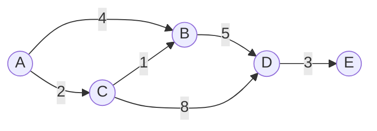
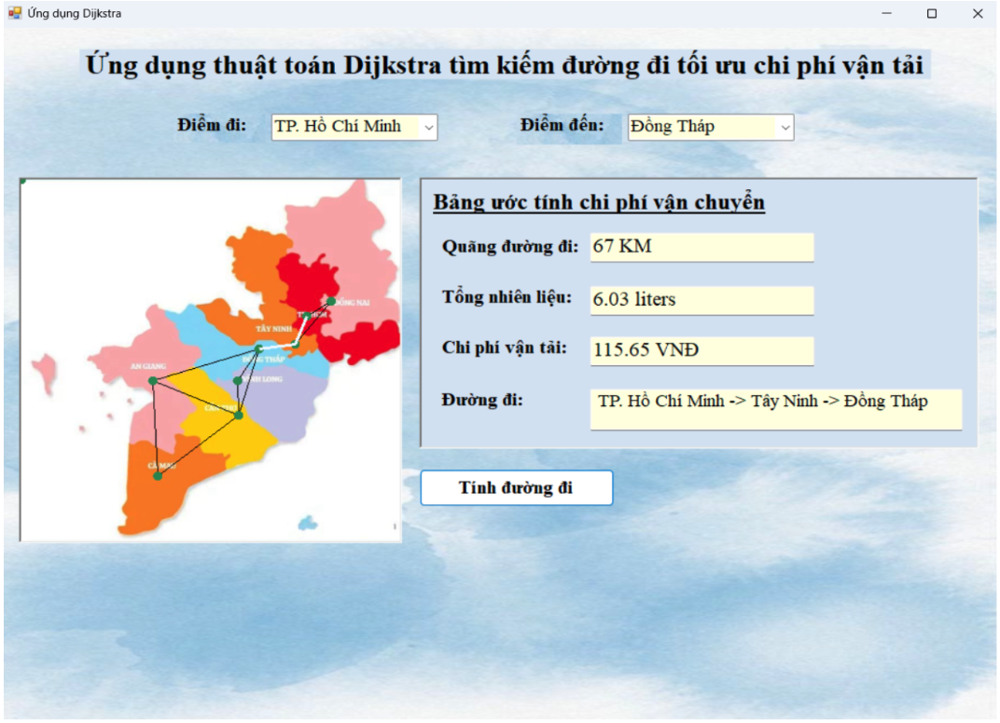

# 🧮 Data Structures & Algorithms

A collection of algorithm implementations I wrote while studying **Data Structures & Algorithms (CTDL & GT)** at the University of Economics Ho Chi Minh City (UEH).


## >_ Algorithms

| Algorithm | Category | Folder | Status |
| --- | --- | --- | --- |
| **Dijkstra's Algorithm** | Graph · Shortest path | [`DijkstraAlgorithm/`](./DijkstraAlgorithm) | ✅ Done |
| _More coming soon_ | | | 🔜 |

---

## >_ Dijkstra's Algorithm

Finds the **shortest path** from one source vertex to every other vertex in a weighted graph with **non-negative edge weights**.

### How it works

1. Set the distance of the source to `0` and every other vertex to `∞`.
2. Pick the unvisited vertex with the smallest known distance.
3. **Relax** its edges: if going through this vertex gives a shorter route to a neighbor, update the neighbor's distance.
4. Mark the vertex as visited and repeat from step 2 until all vertices are processed.

### Worked example



Shortest distances from **A**:

| Vertex | Distance | Path |
| --- | --- | --- |
| A | 0 | A |
| C | 2 | A → C |
| B | 3 | A → C → B |
| D | 8 | A → C → B → D |
| E | 11 | A → C → B → D → E |

Note that `A → B` directly costs 4, but going through C costs only 3, which is exactly what Dijkstra finds.

### Complexity

| Implementation | Time | Space |
| --- | --- | --- |
| Array / linear scan | O(V²) | O(V) |
| Binary heap (priority queue) | O((V + E) log V) | O(V + E) |

> **Limitation:** Dijkstra does not work with negative edge weights. Use Bellman-Ford in that case.

---

## >_ Project Structure

```
CTDL_GT_Algorithm/
└── DijkstraAlgorithm/    # Dijkstra's shortest path implementation
```

## >_ Demo

A Windows Forms app that applies Dijkstra's algorithm to find the lowest-cost transport route between provinces in southern Vietnam.

<p align="center">
  
</p>

| | |
| --- | --- |
| **Input** | Start point and destination (dropdown lists) |
| **Output** | Distance, estimated fuel, transport cost, and the route |
| **Example** | TP. Hồ Chí Minh → Đồng Tháp: **67 km**, **6.03 liters**, route via **Tây Ninh** |

## ▶️ How to Run

**Requirements:** Windows and [Visual Studio](https://visualstudio.microsoft.com/) with the **.NET desktop development** workload.

1. Clone the repository:

   ```bash
   git clone https://github.com/tranannhtu21012006/CTDL_GT_Algorithm.git
   ```

2. Open `DijkstraAlgorithm/DijkstraAlgorithm.sln` in Visual Studio.
3. Press **F5** (or click **Start**) to build and run.
4. Choose a start point and a destination, then click **Tính đường đi**.

## >_ Roadmap

- [x] Dijkstra's Algorithm
- [ ] Add more graph algorithms (BFS, DFS, Bellman-Ford, Floyd-Warshall)

## >_ Author

**Tran Anh Tu (Billy)** · IT undergraduate @ UEH

[](https://www.linkedin.com/in/billytran201/)
[](https://myportfolio-billy.vercel.app)
